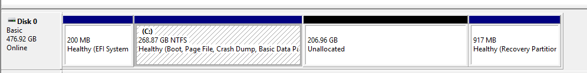
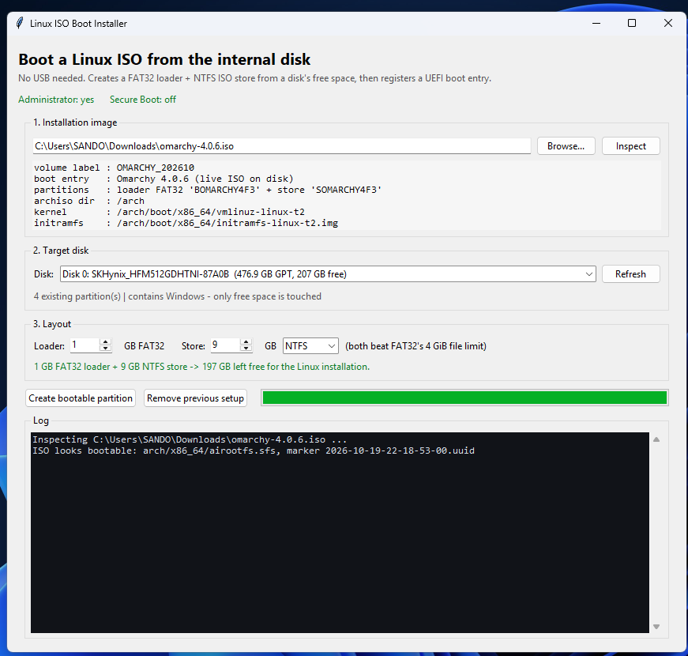
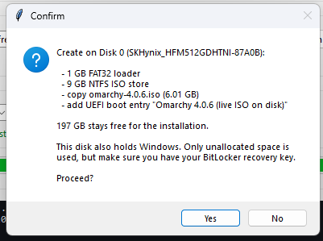
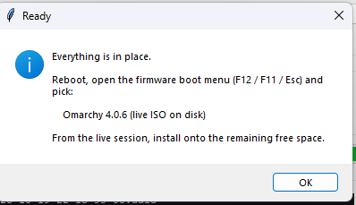
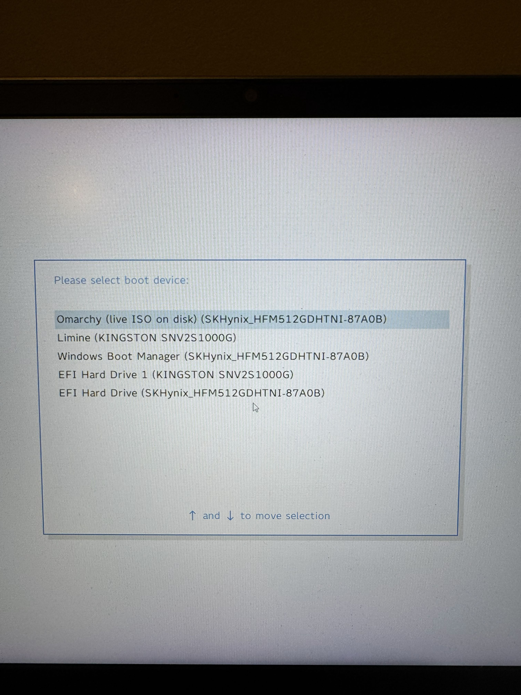
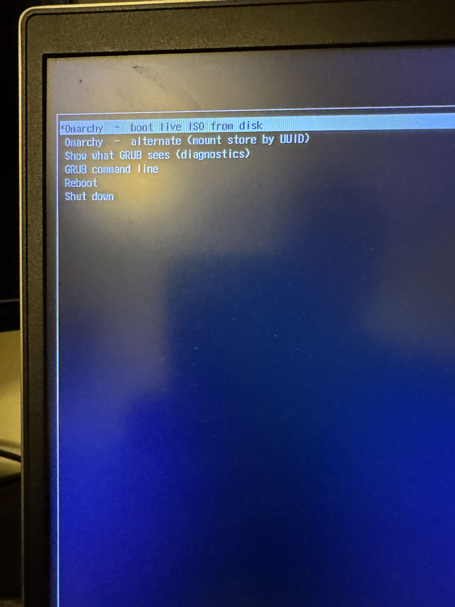
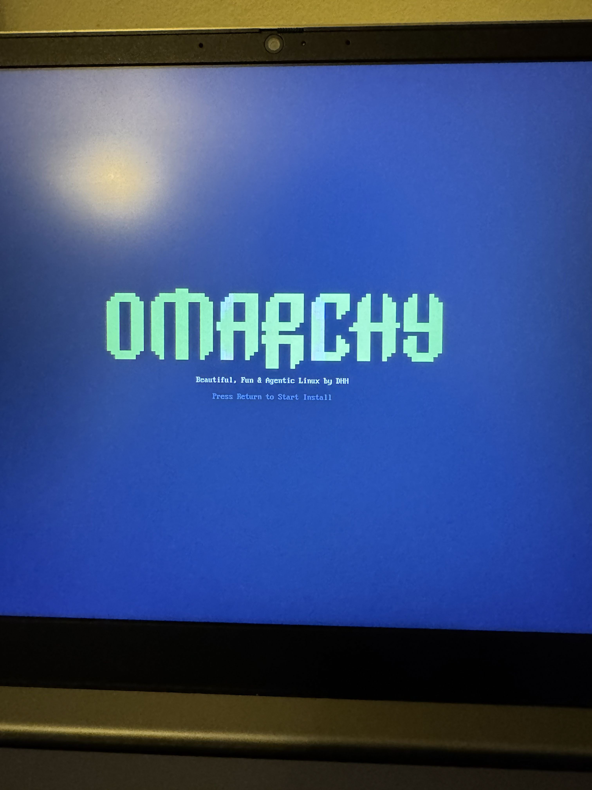

# Boot an archiso ISO from an internal disk (no USB)

Makes an archiso-family ISO — **Omarchy**, Arch, CachyOS, EndeavourOS, … —
bootable straight from free space on an internal disk. No USB stick, no second
machine. Then you install Linux for real onto the space that is left.

> **Built for dual-boot — this is a Linux-alongside-Windows tool, not a
> wipe-the-disk tool.**
>
> It only uses **unallocated** space: no existing partition is resized, moved or
> written to, so Windows keeps booting.
>
> When you install Linux from the live session, choose the installer's
> **Free space install** option. That is the whole point of this setup — it
> installs into the free space and leaves Windows where it is. The full-disk /
> erase-disk option is not what this tool is for.

Target: **Windows 10/11, UEFI + GPT**. Validated against `omarchy-4.0.6.iso`.

| File | Use |
|---|---|
| `omarchy_iso_boot.py` | **the program** — GUI + CLI, Python 3.9+, no dependencies (Windows and Linux) |
| `Run GUI.bat` | double-click launcher for the GUI |
| `Install-LinuxBootPartition.ps1` | older headless PowerShell version (Omarchy labels hard-coded) |
| `packaging/appimage/` | builds the Linux AppImage (see [Linux version](#linux-version)) |
| `screenshots/` | walkthrough images for [setup](#step-by-step-with-screenshots) and [first boot](#first-boot-with-screenshots) |

## Linux version

The same program runs on Linux (tested on Omarchy/Arch). It does the same job:
a FAT32 loader and an ISO store carved from unallocated GPT space, plus a UEFI
boot entry. Nothing is mounted from the ISO; it is read with `bsdtar`.

Runtime tools (Arch/Omarchy):

```bash
sudo pacman -S --needed gptfdisk parted dosfstools ntfsprogs exfatprogs efibootmgr libarchive tk polkit
```

### Get the AppImage

Download `Linux ISO Boot Installer-x86_64.AppImage` from the
[latest release](https://github.com/nightdevil00/ISO-Recovery/releases/latest),
or build it yourself with `packaging/appimage/build.sh` (needs network access; it
downloads a Python AppImage base and `appimagetool`).

Make it executable and start it:

```bash
chmod +x "Linux ISO Boot Installer-x86_64.AppImage"
./"Linux ISO Boot Installer-x86_64.AppImage"
```

The AppImage bundles Python and tkinter, so the target system only needs the
runtime tools above.

### Running on Wayland (Hyprland, Sway, ...)

The GUI is a Tk app, so it runs through XWayland. Two things make it work:

1. **Grant root access to the X display.** The GUI starts read-only. **Relaunch as
   Administrator** starts a root copy, which has to draw on your display. Allow
   local root once per session:

   ```bash
   sudo pacman -S --needed xorg-xhost
   xhost +si:localuser:root
   ```

   `xhost` lists the current access list. The grant lasts until you log out. To
   remove it early: `xhost -si:localuser:root`.

2. **Don't start the GUI with `sudo`.** `sudo` strips `DISPLAY`, so the window
   can't open. Start it normally and click **Relaunch as Administrator**. That
   runs `pkexec` and asks for your password through your polkit agent.

If you need a root shell instead of the button, keep the display variables:

```bash
sudo env DISPLAY="$DISPLAY" ./"Linux ISO Boot Installer-x86_64.AppImage"
```

The elevated window's output goes to `/tmp/linux-iso-boot-relaunch.log`. If the
root window doesn't appear, look there first.

### Running from source

```bash
python3 omarchy_iso_boot.py           # GUI; use Relaunch as Administrator for writes
sudo python3 omarchy_iso_boot.py --selftest
```

Linux-specific behaviour:

* State lives in `/var/lib/linux-iso-boot/state.json`.
* Disks are shown by device path (`/dev/nvme0n1`); partitions are tracked by PARTUUID.
* Free space shown is the largest unpartitioned gap, because a partition must fit in one run.
* Remove deletes UEFI entries by name suffix `(live ISO on disk)`, the same as the Windows version.

## Requirements

* Windows 10 or 11, 64-bit.
* UEFI firmware and a **GPT** disk with unallocated space.
* Administrator rights for the write steps (the app offers a relaunch button).
* Python 3.9+ with tkinter if you run the `.py`. The packaged `.exe` needs nothing.
* **Secure Boot disabled** — the ISO's GRUB is not Microsoft-signed.

## Quick start

Double-click **`Run GUI.bat`**, or:

```powershell
python omarchy_iso_boot.py
```

The app opens **read-only** and:

1. auto-selects the newest ISO in your Downloads folder (use **Browse…** to pick another),
2. validates the ISO without writing anything,
3. auto-selects the disk with the most free space,
4. shows the exact partition layout and the boot-entry name.

Then click **Relaunch as Administrator** and **Create bootable partition**.
The Create button stays disabled until everything checks out.

Reboot into the live ISO, then install Linux with **Free space install** — see
[Installing Linux for real](#installing-linux-for-real--choose-free-space-install).

## Step by step (with screenshots)

### 1. Prepare the disk — shrink a volume first

The tool only uses **unallocated** space; it never resizes or moves a partition.
If the target disk has no free space, shrink an existing volume first:

1. Right-click **Start → Disk Management** (or press `Win+X`, then `K`).
2. Right-click the volume you want to shrink (usually `C:`) → **Shrink Volume**.
3. Shrink by at least **20 GB** — that covers the 1 GB loader, the ~9 GB ISO
   store, and leaves room for the real Linux install. More is better.
4. Leave the freed space **unallocated**. Do not create a new volume in it.

[](screenshots/disk_preparation.png)

### 2. Run it as Administrator and select the ISO

Start the GUI, then click **Relaunch as Administrator** (the status strip must say
`Administrator: yes`). Use **Browse…** to pick your ISO, then **Inspect**.

Check the image details panel: it shows the kernel, initramfs, marker, generated
volume labels and the boot-entry name. If the ISO is not archiso-based, the app
refuses it here — before anything is written.

[](screenshots/GUI.png)

### 3. Choose the disk and click Create bootable partition

Pick the disk that has the unallocated space. The layout line must be green and
show enough room left over for the installation. Then click
**Create bootable partition**.

### 4. Confirm

The confirmation lists exactly what will be created: the FAT32 loader, the ISO
store, the copy, and the UEFI boot entry. Approve it to start.

[](screenshots/accept.png)

### 5. Finish

The log shows each step, then a completion dialog. Reboot, open the firmware boot
menu (`F12` / `F11` / `Esc`) and choose the entry named after your ISO.

[](screenshots/finish.png)

> Screenshots live in `screenshots/` next to this README. Replace them with your
> own capture using the same file names if you want to update the walkthrough.


## What it creates

Two partitions out of the chosen disk's **unallocated** space. No existing
partition is resized, moved, or written to. Labels are derived from the ISO file
name, so they are unique per ISO and fit FAT32's 11-character limit:

```
[ FAT32  loader ]  1 GB   BOMARCHY4F3     (B + name + 3-char tag)
    \EFI\BOOT\BOOTx64.EFI              <- GRUB, taken from the ISO
    + a UEFI boot entry pointing at it

[ NTFS   store  ]  9 GB   SOMARCHY4F3     (S + name + 3-char tag)
    \omarchy-4.0.6.iso                 <- the ISO, untouched (6 GB)
    \boot\2026-10-19-22-18-53-00.uuid  <- marker file from the ISO
    \boot\grub\grub.cfg                <- generated: loopback-boots the ISO

[ remaining free space ]               <- your real Linux install (Free space install)
```

The boot entry is named after the ISO, e.g. **`Omarchy 4.0.6 (live ISO on disk)`**.

## Why it is split in two

* UEFI firmware can only read **FAT32**, so the bootloader must live there.
* The ISO is 6.01 GB and its `airootfs.sfs` alone is 5.71 GB, but **FAT32 caps
  files at 4 GiB**. So the ISO lives on NTFS/exFAT (the initramfs carries
  `ntfs3`), while only GRUB sits on FAT32.

## Boot chain

1. Firmware loads `\EFI\BOOT\BOOTx64.EFI` from the FAT32 loader partition.
2. That GRUB is an archiso "bootloader with hint" build. It searches every
   readable filesystem for `/boot/2026-10-19-22-18-53-00.uuid` and, having found
   it on the ISO store, loads `/boot/grub/grub.cfg` **from there** and exports
   `ARCHISO_HINT` (GRUB device) and `ARCHISO_UUID`.
3. Our `grub.cfg` loopback-mounts the `.iso` and boots its kernel with
   `img_dev=/dev/disk/by-label/<store label> img_loop=<the .iso>`.
4. The archiso initramfs mounts that partition, loop-mounts the ISO, and starts
   the live environment.

Everything here is read from the ISO at inspection time — basedir, kernel,
initramfs, marker name and store label — so nothing is Omarchy-specific.

## Idempotency and safety

Running the program twice does **not** create four partitions:

* **Before writing anything** it checks `%ProgramData%\LinuxBootPartition\state.json`.
  If a previous setup is recorded it stops and says to run **Remove previous
  setup** first. Nothing is modified.
* A partial run (crash during the 6 GB copy) is also recorded, so Remove can
  clean it up.
* Leftover partitions from a crashed run that lost its state are detected by
  label and removed before a new pair is created.
* If the store partition cannot be created, the loader partition is rolled back.
* Boot entries and partitions are stored and removed by **partition GUID**, not
  by partition number. Windows renumbers partitions, so a stale number can point
  at the wrong partition.
* Stale boot entries with the same description are removed before a new one is added.
* Remove is safe when there is nothing to remove — it reports "Nothing to remove"
  instead of failing.
* State written by version 1.0 (`OMARCHYBOOT` / `OMARCHY_ISO`) is understood and
  cleaned up by the same Remove button.

## Works on other machines?

**Yes, within these limits.** The ISO handling is genuinely generic: it accepts
any archiso build whose EFI loader supports `ARCHISO_HINT` discovery and GRUB
`loopback`, and it refuses anything else instead of guessing. It runs on any
Windows 10/11 machine with UEFI + GPT. It does not assume this laptop's disk
numbers, drive letters, ISO path, or Downloads location (OneDrive-redirected
Downloads is handled).

Hard requirements that come from Windows, not from this app:

* Windows only (it drives `Get-Partition`, `Format-Volume` and `bcdedit`).
* UEFI + GPT only; there is no Legacy BIOS path.
* An existing Windows Boot Manager, because the UEFI entry is made with
  `bcdedit /copy {bootmgr}`.
* Administrator rights.
* Secure Boot off.

If the target machine's firmware UI cannot boot the entry, use its one-time boot
menu and pick the ISO's description; if that still fails, the GRUB diagnostics
entry prints what it sees.

## Distributing it

The script is a single self-contained file with **no third-party packages**
(tkinter is part of Python). To ship it:

**Option A — send the files.** Give the user `omarchy_iso_boot.py` and, if they
want it, `Run GUI.bat`. They need Python 3.9+ from python.org with the default
"tcl/tk" component.

**Option B — a single .exe (no Python needed).** On a Windows build machine:

```powershell
python -m pip install pyinstaller
pyinstaller --onefile --windowed --name "ISO Boot Installer" omarchy_iso_boot.py
# -> dist\ISO Boot Installer.exe
```

Upload that `.exe`. It embeds Python and tkinter; the receiving machine needs no
installer and no admin rights just to open it (admin is still needed to write).

Keep the `.exe` clean by building it on a normal Windows 10/11 x64 machine; do
not rename it to something that looks like a Windows system tool.

## Command line

```powershell
python omarchy_iso_boot.py              # GUI
python omarchy_iso_boot.py --selftest   # disks + ISO + rendered grub.cfg, changes nothing
python omarchy_iso_boot.py --gui-check  # builds the window headlessly, prints widget state
python omarchy_iso_boot.py --remove     # undo (needs Administrator)
python omarchy_iso_boot.py --version
python omarchy_iso_boot.py --help
```

State lives in `%ProgramData%\LinuxBootPartition\state.json`, so the GUI and the
CLI can undo each other's work.

## PowerShell version

`Install-LinuxBootPartition.ps1` still does the same job headlessly, but it is
the older front-end: hard-coded `OMARCHYBOOT` / `OMARCHY_ISO` labels, and it does
not have the preflight/GUID protections above. Prefer the Python program.

```powershell
.\Install-LinuxBootPartition.ps1 -DryRun
.\Install-LinuxBootPartition.ps1 -IsoPath C:\Users\you\Downloads\omarchy-4.0.6.iso
.\Install-LinuxBootPartition.ps1 -Remove
```

## Before you reboot

* **Turn Secure Boot off** in firmware setup.
* **Note your BitLocker recovery key** if `C:` is encrypted
  (`manage-bde -status C:`). Only free space is touched, but keep it handy.
* **Installing Omarchy alongside Windows needs BitLocker off.** Omarchy's
  dual-boot install is not compatible with BitLocker on that disk — decrypt `C:`
  first (Settings → Privacy & Security → Device encryption).
* The boot entry is added **first** in the boot order. Windows still appears in
  the firmware boot menu.

## Boot it

Reboot and press **F12 / F11 / Esc**, then choose the entry named after your ISO,
e.g. **"Omarchy 4.0.6 (live ISO on disk)"**.

## First boot (with screenshots)

### 1. Pick the entry in the firmware boot menu

Open the one-time boot menu (`F12` / `F11` / `Esc`, depending on the vendor) and
select the entry this tool created — it is named after your ISO.

[](screenshots/bootmenu.jpg)

### 2. Pick the first GRUB entry

The ISO's GRUB menu appears. Choose the first entry,
**“boot live ISO from disk”** (or let the 10-second timeout pick it for you).
The second entry is the UUID fallback used only if the first one fails.

[](screenshots/grub_mode.jpg)

### 3. Omarchy starts

The archiso initramfs loop-mounts the ISO from the store partition and boots the
live environment. The first Omarchy screen means the whole chain worked: firmware
→ FAT32 loader → ISO GRUB → NTFS store → live system.

[](screenshots/omarchy_setup.jpg)

## Installing Linux for real — choose **Free space install**

You land in the live environment and the installer asks how to use the disk.
This is the step that decides whether you get a dual-boot, so pick carefully.

1. **Select the disk** that holds the unallocated space you prepared.
2. **Choose `Free space install`.** That option installs into the free space and
   leaves every existing partition — Windows included — exactly where it is.
   **Do not** choose the full-disk / erase-disk option: it deletes Windows and
   the loader this tool just created.
3. **Install into the free space left after the store partition.** Leave the
   1 GB loader partition alone (do not reformat it) and point `/efi` at it — it
   is already FAT32 and becomes your permanent EFI partition.
4. **Do not** install onto the ~9 GB store partition — the live system is reading
   the ISO from it.
5. Finish the install as usual.

Because the loader partition becomes your `/efi`, **Remove previous setup** is
only an undo for *before* you install. Running it afterwards deletes both
temporary partitions, including the one now holding your bootloader.

## If it does not boot

Pick **"Show what GRUB sees"** in the boot menu: it prints `ARCHISO_HINT`,
`ARCHISO_UUID`, the ISO path and `ls` of all devices. Then try the
**alternate (mount store by UUID)** entry.

The config is plain text and the store stays writable in Windows, so you can edit
and retry without re-running anything:

```
<store drive>:\boot\grub\grub.cfg
```

## Undo

GUI: **Remove previous setup**. CLI: `python omarchy_iso_boot.py --remove`.

Deletes the boot entry and both partitions, returning the space to unallocated.
Old 1.0 partitions (`OMARCHYBOOT` / `OMARCHY_ISO`) are cleaned up too.

**Caveat:** if you already installed Linux onto the free space, remove that
install first — this only removes the two partitions the tool created.

## Limits

* UEFI + GPT only (no Legacy BIOS path).
* archiso-family ISOs only. It validates `<basedir>/x86_64/airootfs.sfs`, the
  `/boot/*.uuid` marker, and `ARCHISO_HINT` + `loopback` inside `BOOTx64.EFI`,
  and refuses anything else.
* Other distros: Ubuntu/Mint/Pop can use the simpler "extract to FAT32 +
  `bcdedit`" trick; Fedora/openSUSE need Ventoy or a raw image.
